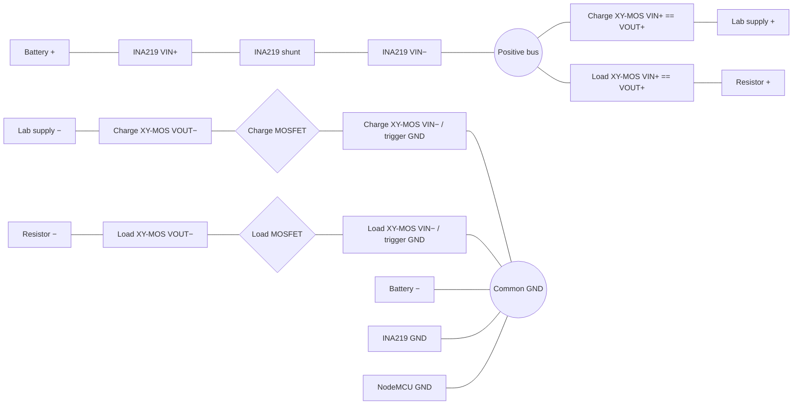

# LiFePO4 Battery Characterizer

A small DIY project for collecting repeatable LiFePO4 discharge curves. One MOSFET connects a lab supply for charging; another connects a resistive load for discharge measurements.

Starting from a consistent charged condition, the controller waits for charge current to taper, lets the battery settle, then alternates load and no-load periods. It stops on a manual `off` command, low voltage, or an overcurrent safeguard. Each run ends with the outputs off and does not restart automatically.

The ESP8266 publishes INA219 readings and experiment status to Home Assistant over Wi-Fi and MQTT with MQTT Discovery.

## Hardware

- Protected single-cell LiFePO4 battery, 3.2 V nominal, 6 Ah
- NodeMCU ESP8266
- INA219 high-side current/voltage sensor, configured at I2C address `0x44`
- Two XY-MOS low-side switch boards with dual D4184 MOSFETs: one charge branch and one load branch
- Adjustable CC/CV lab supply, currently set to 3.6 V
- Resistor loads; the initial load test uses 12 Ω

## Wiring

The INA219 shunt is in the shared battery-positive path. On these XY-MOS boards, `VIN+` and `VOUT+` are permanently connected, while the negative path is switched. The board schematic ties trigger GND to `VIN−`; the working wiring connects `VIN−` to common ground and uses `VOUT−` for the switched branch return.

Only each branch's negative return is switched; both positive pass-throughs remain at battery-positive potential. Keep lab-supply negative isolated from common GND except through its MOSFET branch, or that switch will be bypassed. The software is experimental and is not battery protection.

## Configuration

Copy `include/config.h.template` to `include/config.h` and set local network details. Keep both files structurally aligned: preserve the same comments and non-confidential values, and make changes to shared settings in both files. Only local endpoints and credentials should differ. The local `config.h` is ignored by Git.

This is a supervised characterization prototype, not a battery protection system. Verify the battery limits and hardware before use.
